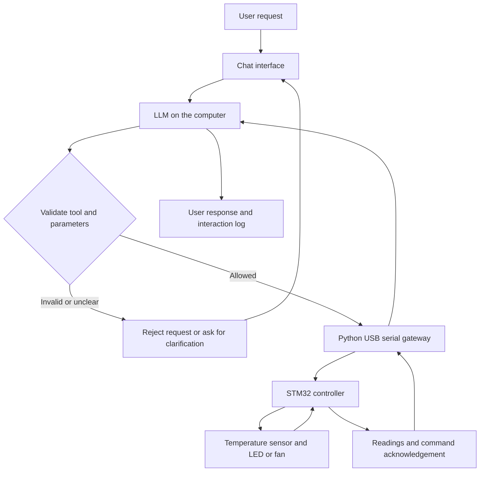

# Agentic Control Lab

### A natural-language interface for STM32 monitoring and control

Agentic Control Lab explores how a large language model can help users interact with a small physical system through chat. The proposed prototype reads temperature and controls an LED or a low-voltage fan using an STM32 controller.

**Status:** Proposal and system design. Firmware, application code, and hardware test results are planned and are not yet included.

**Author:** Ku Kwang Yaw  
**Academic project:** FYP-126  
**Formal title:** Development of an Agentic LLM Interface for Monitoring and Control of STM32-Based Cyber-Physical Systems

## Objectives

1. **Develop a simple LLM chat interface.** Let users ask for readings and request device control in plain English.
2. **Connect the interface to an STM32 system.** Read temperature, control an LED or fan, and return device status through USB serial communication.
3. **Evaluate the system.** Measure command accuracy and response time, and check how it handles unclear requests, invalid commands, and connection failures.

## Example interaction

> Turn on the fan if the temperature is above 30 °C.

The planned agent first requests a temperature reading. If the reading is above the threshold, it requests fan activation through an allowed tool. The interface reports the result after receiving the controller's acknowledgement. A failed or missing acknowledgement is reported as an error.

This is an intended interaction, not a recorded demonstration.

## Proposed architecture



The computer hosts the LLM and application. The STM32 handles sensor access, device outputs, and local control limits. The LLM provides supervisory commands; timing-sensitive hardware behavior remains in the firmware.

## Planned hardware

| Component | Purpose |
| --- | --- |
| STM32 Nucleo board, such as NUCLEO-F446RE | Main controller |
| Temperature sensor compatible with 3.3 V logic | Temperature monitoring |
| LED and resistor | Simple control output |
| Low-voltage DC fan | Conditional-control demonstration |
| Suitable fan driver with protection | Fan switching |
| Regulated low-voltage supply | Fan and driver power |
| Breadboard, jumper wires, and USB cable | Prototyping and communication |
| Manual stop button | Local stop input |
| Laptop or PC | LLM, interface, gateway, and logs |

Final part numbers and wiring will be selected during hardware development.

## Planned software

| Software | Purpose |
| --- | --- |
| STM32CubeIDE and C/C++ | Firmware development and debugging |
| Python and pySerial | Command validation and serial communication |
| Streamlit | Chat interface and readings display |
| Ollama with a tool-capable LLM | Request interpretation and tool selection |
| CSV files | Test and interaction logs |
| Firebase, optional | Online storage of readings |
| Git | Version control |

The LLM will be selected according to the available computer resources and tool-calling performance. Firebase is optional and is not required for the initial USB prototype.

## Control safeguards

- Allow only predefined tools and valid parameter values.
- Keep output limits and the manual stop in the STM32 firmware.
- Turn the fan off after reset or a control-link timeout.
- Confirm execution using controller acknowledgements.
- Bound the number of agent steps per request.
- Use low-voltage DC demonstration loads.

## Development roadmap

- [x] Define project scope and objectives.
- [x] Prepare the proposal and architecture.
- [ ] Select components and a tool-capable model.
- [ ] Build and test sensor and output firmware.
- [ ] Implement the serial gateway and command validation.
- [ ] Build the chat interface and integrate LLM tools.
- [ ] Test monitoring, conditional control, and failure handling.
- [ ] Record results and prepare a demonstration.

## Project documents

- [Editable Word proposal](docs/Project_Proposal.docx)
- [System design](docs/system-design.md)
- [Evaluation plan](docs/evaluation-plan.md)

## Repository structure

```text
agentic-control-lab/
├── README.md
├── .gitignore
└── docs/
    ├── Project_Proposal.docx
    ├── system-design.md
    └── evaluation-plan.md
```

Application and firmware directories will be added when implementation begins. There are no installation or execution steps yet because this repository currently contains project documentation.

## Technical references

- [STMicroelectronics NUCLEO-F446RE](https://www.st.com/en/evaluation-tools/nucleo-f446re.html)
- [Ollama tool support](https://ollama.com/blog/tool-support)

## License

No open-source license has been selected. Contact the author before reusing or distributing project materials.
